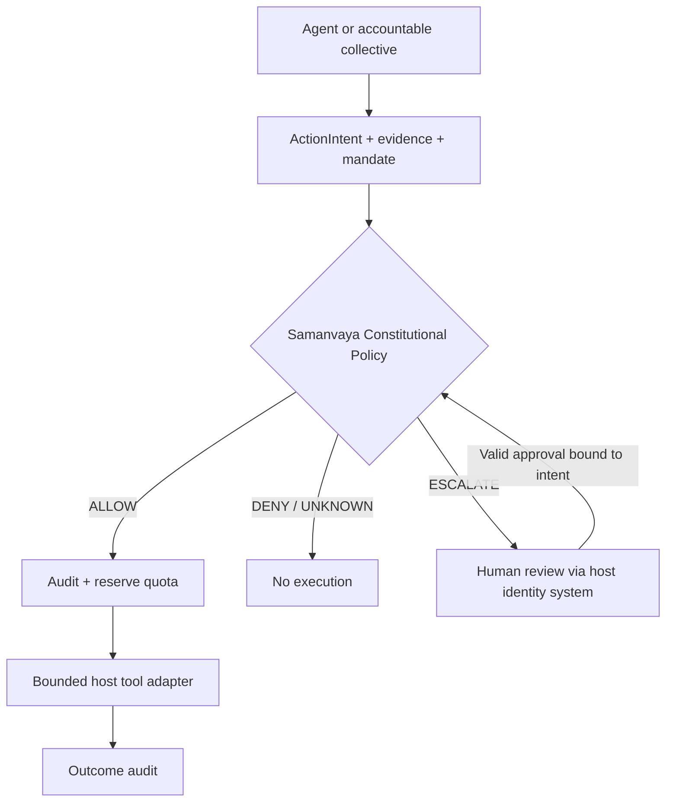

<p align="center">
  
</p>

# SAMANVAYA

**An executable constitution for accountable AI agent collectives.**

*Ṛta · Dharma · Adhikāra · Samanvaya · Punarnavīkaraṇa*

> Intelligence may be distributed. Responsibility cannot disappear.

**Status: v0.2 experimental research baseline (24 November 2026). Not production-secure.**

Samanvaya is a small, standard-library Python constitutional kernel. It borrows HUAP's useful trace-first philosophy—replay, diff, explicit contracts, evaluation-oriented testing—while placing **legitimate authority** in front of consequential agent actions. Its objective is to become an enforceable, inspectable governance layer for agent systems, not a new LLM framework or another general-purpose UI.

The five Sanskrit-derived architectural principles are design inspirations, **not claims that classical Vedic texts directly specified software requirements**. See [VEDIC_FOUNDATIONS.md](docs/VEDIC_FOUNDATIONS.md).

## What is new in v0.2: constitutional coherence + finite-catalog repair

**Samanvaya now tests an explicit differentiating hypothesis**: an individually authorized agent action can still be inadmissible as part of a larger plan because its facts, duties or interdependent actions are inconsistent. Instead of merely denying it, Samanvaya can search *operator-supplied, finite alternatives* for the least-cost **admissible proposed plan**, with a precise minimality claim **only inside the exhausted catalog**. No agent is authorized to fabricate evidence, issue new mandates or automatically accept a repair.

- `src/samanvaya/coherence.py`: typed whole-plan `FactObligation`, `BeforeObligation`, `ExclusionObligation` and temporal evidence witnesses.
- `src/samanvaya/repair.py`: uniform-cost bounded search over trusted replacement/drop options; `minimal_proven_within_catalog` is false if search is incomplete.
- `src/samanvaya/adapters/broker.py`: existing gateway plus whole-plan preflight, trusted tool bindings and exact argument-digest checks.
- `src/samanvaya/adapters/langchain_v1.py`: optional LangChain v1 `wrap_tool_call` middleware, without importing LangChain from the core.

**Reproducible local demonstration** (no LLM calls or external side effects):

```bash
python -m pip install -e .
python examples/land_community_demo.py
python benchmarks/reference_suite.py
python -m unittest discover -s tests -v
```

The demo shows `action=ALLOW` but `whole_plan=UNKNOWN`, so the broker blocks the tool. A trusted alternative ('survey first') is then proposed, re-evaluated and executed as a **simulation** only after operator selection.

For actual LangChain integration (requires network for dependency installation; commands below use a POSIX shell):

```bash
python -m pip install -e '.[langchain]'
SAMANVAYA_REQUIRE_LANGCHAIN=1 python -m unittest tests.test_langchain_real -v
```

**No uniqueness claim yet.** Microsoft AGT/ACS, OPA, Cedar, AGP and LangChain already provide substantial governance functionality. Read [differentiator and prior-art boundaries](docs/DIFFERENTIATOR_AND_NON_DUPLICATION.md), [integration protocol](docs/FRAMEWORK_PORTABILITY.md), and [experimental benchmark](docs/EXPERIMENT_PROTOCOL.md). The local environment did not have LangChain installed; integration contract tests passed, while a dedicated CI job is configured to run the actual framework tests upon publication.

## What works now

- **Constitutional gateway**: agent requests are checked before the registered callable executes.
- **Ṛta / evidence**: missing evidence becomes `UNKNOWN`; conflicting evidence becomes `DENY`.
- **Dharma / purpose**: actions must match a bounded purpose; declared harm is refused pending repair.
- **Adhikāra / mandates**: explicit issuer, holder, verb, resource scope, purpose, permitted effect, expiration, quota, constrained delegation and revocation.
- **Samanvaya / hyperedges**: explicit agent collectives with unique members, quorum and a named accountable human principal; collectives cannot inherit the union of member permissions.
- **Punarnavīkaraṇa / correction**: expiration, revocation cascades, and intent-scoped human review.
- **Audit + replay**: chain-linked JSONL decision audit, integrity check, semantic diff, and no-side-effect re-evaluation of decisions using a fresh policy.
- **HUAP compatibility**: read-only inspection of existing HUAP JSONL traces. Legacy traces do **not** convey authority.
- **44 collected tests** (42 passed, 2 optional live LangChain tests skipped locally); core has no external runtime dependencies.

## What does **not** work yet

**Do not mistake this for a production security boundary.** Identity strings, evidence `verified` status, human approvals and collective endorsements are **caller assertions**; there are no cryptographic signatures, authenticated human sessions, process sandbox, durable transactional quota ledger, network isolation, or distributed consensus. Agents can bypass the gateway if the host application gives them raw tool access. A local JSONL hash chain does not independently authenticate its own origin.

The first hardening priority is secure, exclusive integration at every tool/side-effect boundary, followed by authenticated principals and attestations. See [SECURITY.md](docs/SECURITY.md), [ROADMAP.md](docs/ROADMAP.md) and [HANDOFF_FOR_CLAUDE_CODEX.md](docs/HANDOFF_FOR_CLAUDE_CODEX.md).

## Install and run (Python 3.11+)

```bash
python -m pip install -e .
python -m unittest discover -s tests -v
python -m samanvaya demo --audit ./demo.jsonl
python -m samanvaya verify-audit ./demo.jsonl
```

The demo simulates three cases without calling external services:

```text
safe-read: ALLOW (...), executed=True
escalate-publish: ESCALATE (human_review_required), executed=False
deny-deletion: DENY (action_out_of_scope), executed=False
```

See [`examples/collective_demo.py`](examples/collective_demo.py) for collective-action quorum and bounded authority, and [`examples/legacy_huap_event.jsonl`](examples/legacy_huap_event.jsonl) for a minimal HUAP trace example.

## Minimal Python API

```python
from datetime import timedelta
from samanvaya import (
    ActionIntent, AuditLog, ConstitutionConfig, ConstitutionalGateway,
    ConstitutionalPolicy, Effect, Mandate, MandateBook,
)
from samanvaya.models import utcnow

mandates = MandateBook(root_issuers=("human:owner",))
mandates.issue(Mandate(
    mandate_id="m1", issuer="human:owner", holder="agent:analyst",
    actions=("read",), resource_scopes=("repo:reports",),
    purposes=("research",), allowed_effects=(Effect.READ,),
    expires_at=utcnow() + timedelta(hours=1), max_uses=10,
))
policy = ConstitutionalPolicy(mandates, ConstitutionConfig(("human:owner",)))
gateway = ConstitutionalGateway(policy, AuditLog("./decisions.jsonl"))
intent = ActionIntent("i1", "agent:analyst", "m1", "read",
                      "repo:reports/notes", "research", Effect.READ)
receipt = gateway.execute(intent, lambda: "simulated read")
assert receipt.executed and receipt.result == "simulated read"
```

This demonstrates policy behavior only; `human:owner` is not authenticated in this example.

## Repository map

```text
src/samanvaya/
  models.py           Typed intentions, mandates, evidence, approvals, collectives
  mandates.py         Bounded issuance, delegation, quota, scope, revocation
  constitution.py     The five-pillar decision engine
  gateway.py          Check + log + reserve + side-effect adapter boundary
  audit.py            Chain-linked JSONL verification and semantic diff
  replay.py           Side-effect-free constitutional decision replay
  compat/huap_trace.py  Read-only legacy HUAP JSONL compatibility
  cli.py              Demo, verify-audit, inspect-huap
examples/             Collective demo, sample HUAP trace
 tests/               Policy, replay, HUAP compatibility and adversarial tests
 docs/                Charter, architecture, 12-law matrix, ADRs, security, migration
```

## Fundamental separation



*The demo uses simulated review and tools. External enforcement and authenticated human identity are future work.*

## Documentation

- [CONSTITUTION.md](docs/CONSTITUTION.md) — normative kernel charter and invariants
- [VEDIC_FOUNDATIONS.md](docs/VEDIC_FOUNDATIONS.md) — why these five organizing principles
- [ARCHITECTURE.md](docs/ARCHITECTURE.md) — boundaries, objects, flow and hypergraphs
- [TWELVE_LAWS_MATRIX.md](docs/TWELVE_LAWS_MATRIX.md) — provisional map to Srinivas Gutta's 12-law series, with source-verification flags
- [HUAP_SALVAGE.md](docs/HUAP_SALVAGE.md) — what we retained conceptually and why
- [SECURITY.md](docs/SECURITY.md) — actual guarantees vs threat-model gaps
- [ROADMAP.md](docs/ROADMAP.md) — subsequent engineering milestones
- [HANDOFF_FOR_CLAUDE_CODEX.md](docs/HANDOFF_FOR_CLAUDE_CODEX.md) — task brief and acceptance gates
- [DIFFERENTIATOR_AND_NON_DUPLICATION.md](docs/DIFFERENTIATOR_AND_NON_DUPLICATION.md) — prior-art audit, research hypothesis and stop/go test
- [FRAMEWORK_PORTABILITY.md](docs/FRAMEWORK_PORTABILITY.md) — LangChain 1.x integration and no-bypass requirements
- [EXPERIMENT_PROTOCOL.md](docs/EXPERIMENT_PROTOCOL.md) — benchmark and finite-catalog proof conditions
- [VALIDATION_REPORT.md](docs/VALIDATION_REPORT.md) — tests actually executed vs pending
- [CLAUDE_CODEX_V02_HANDOFF.md](docs/CLAUDE_CODEX_V02_HANDOFF.md) — v0.2 next steps
- [ADRs](docs/adr/README.md) — permanent architecture choices

## Origins, rights and acknowledgements

This codebase is a **clean small kernel with explicit conceptual lineage**, not a byte-for-byte fork of HUAP. The HUAP public repository supplied the tracing, replay, policy hook, pod, human gate and test/CI design patterns; the executable constitution here is newly implemented. HUAP was reviewed on 23 November 2026. Source: https://github.com/Mircus/HUAP. See [NOTICE](NOTICE) and [HUAP_SALVAGE.md](docs/HUAP_SALVAGE.md).

Conceptual dialogue: Srinivas Gutta's **Twelve Laws of Agentic AI**, especially articles 8 (accountability), 10 (non-delegable authority), and 12 (governability). The law matrix is expressly **provisional** pending an article-by-article verified audit and does not claim to reproduce his actual texts.

MIT license. Early baseline maintained as a **starting point for Claude/Codex refinement**, not as a deployed platform.

## v0.2 next engineering steps

Use [`docs/CLAUDE_CODEX_V02_HANDOFF.md`](docs/CLAUDE_CODEX_V02_HANDOFF.md) rather than adding more generic governance features. The previous v0.1 handoff remains as architectural and security background. Authenticating evidence/principals and demonstrating a non-bypassable tool service are prerequisites before production use.
