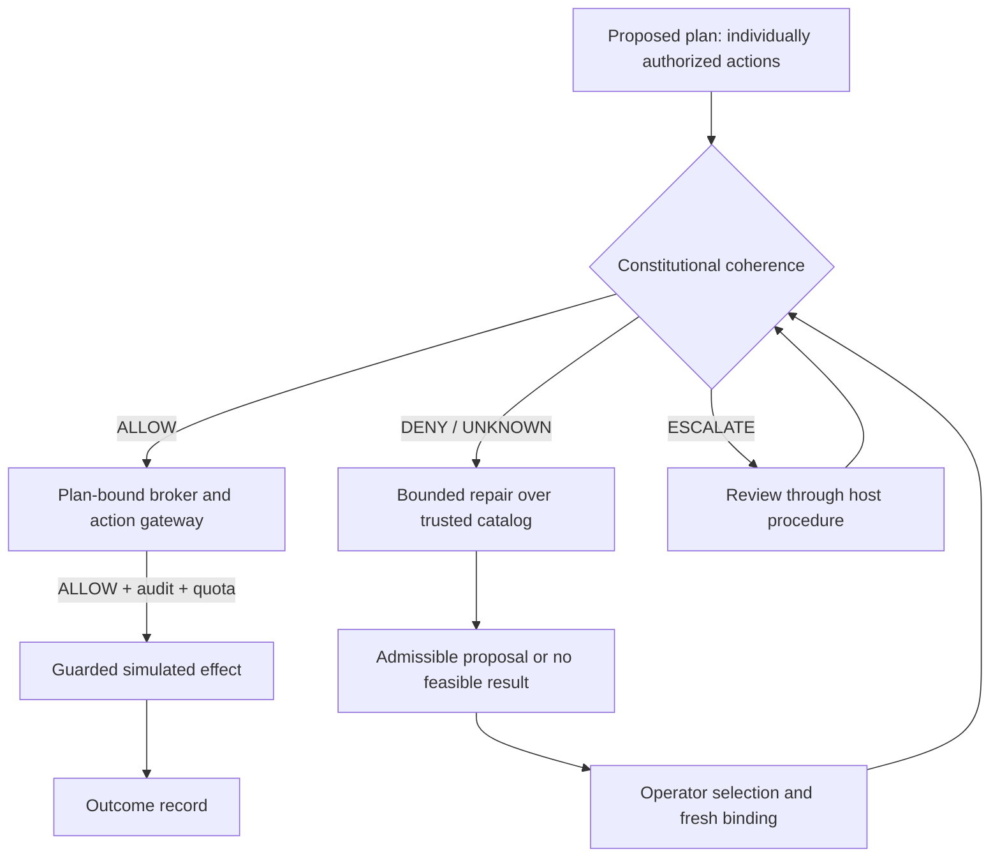

<p align="center">
  
</p>

<h1 align="center">SAMANVAYA</h1>
<p align="center"><strong>An executable constitution for accountable AI agent collectives.</strong></p>
<p align="center"><em>Ṛta · Dharma · Adhikāra · Samanvaya · Punarnavīkaraṇa</em></p>

<p align="center">
  <a href="https://github.com/Mircus/Samanvaya/actions/workflows/ci.yml"></a>
  <a href="pyproject.toml"></a>
  <a href="LICENSE"></a>
  <a href="CHANGELOG.md"></a>
  <a href="docs/SECURITY.md"></a>
  <a href="https://colab.research.google.com/github/Mircus/Samanvaya/blob/main/notebooks/Samanvaya_Lab.ipynb"></a>
</p>

> **Intelligence may be distributed. Responsibility cannot disappear.**

Samanvaya explores a problem at the intersection of agentic AI, formal reasoning and governance: **when is an intelligent collective legitimately entitled to act — and how can an inadmissible plan be repaired?**

It is a small, deterministic, standard-library Python research kernel, not another agent runtime. It is designed to complement existing frameworks by checking explicit mandates, evidence, duties and plan-level obligations before cooperating tools execute. v0.2 adds bounded constructive repair: search trusted alternatives and report a least-cost admissible proposal, with minimality scoped to a fully explored finite catalog.

> [!IMPORTANT]
> **Experimental v0.2.0, not a production security boundary.** Identities, approvals, endorsements and evidence status are caller assertions. A host that exposes raw credentials can bypass the broker. No real payments, privileged cloud operations, medical data, or other consequential effects should be entrusted to this prototype. See [security model](docs/SECURITY.md).

## Start here

| Resource | What it offers |
|---|---|
| **[Read the booklet (PDF)](book/Samanvaya_v0.2.pdf)** | Second educational edition: philosophy, architecture, whole-plan coherence, mathematical repair, integration and exercises. |
| **[Run the lab in Colab](https://colab.research.google.com/github/Mircus/Samanvaya/blob/main/notebooks/Samanvaya_Lab.ipynb)** | Hands-on experiments with the actual kernel; no API key or remote model calls. Installation requires network access. |
| **[Land-community demo](examples/land_community_demo.py)** | A locally authorized action is blocked by a missing whole-plan fact; a trusted survey alternative is proposed. All effects are simulated. |
| **[Constitution](docs/CONSTITUTION.md)** | Normative charter and architectural invariants. |
| **[Research hypothesis](docs/DIFFERENTIATOR_AND_NON_DUPLICATION.md)** | Prior-art boundaries, proposed comparative evaluation and stop/go criteria. |
| **[Contribute](CONTRIBUTING.md)** | Reproduce, critique, extend and test the research. |

## Why Samanvaya?

Being able to call a tool does not confer the right to use it. Being authorized to perform each individual step does not guarantee that the resulting plan is coherent. And refusing an inadmissible action does not tell us what legitimate course to pursue instead.

The v0.2 research program is deliberately narrow:

1. **Whole-plan admissibility:** detect fact gaps, contradictions, order violations and mutually exclusive actions that individual permission checks cannot capture.
2. **Constructive repair:** search a trusted finite catalog of changes for admissible alternatives without granting new authority or inventing evidence.
3. **Portability:** attach this analysis to existing tool execution loops rather than replacing the runtime.

These are implemented research hypotheses, not established research firsts. Existing governance and constraint-solving tools may supply equivalent functionality; comparative evaluation is still needed.

## The constitutional pentad

| Principle | Architectural interpretation |
|---|---|
| **Ṛta** — order | Evidence, consistency, uncertainty and freshness |
| **Dharma** — duty | Purpose, responsibilities and declared harms |
| **Adhikāra** — authority | Bounded mandates, attenuation, expiry, revocation |
| **Samanvaya** — coordination | Collective hyperedges, quorum and accountable principals |
| **Punarnavīkaraṇa** — renewal | Review, correction, revalidation and repair |

These Sanskrit-derived terms are philosophical design inspirations, not claims that ancient texts specified software requirements. See [Vedic foundations](docs/VEDIC_FOUNDATIONS.md).

## From authorization to repair



The diagram depicts the cooperative research prototype. A production host would have to enforce the boundary independently, authenticate principals and isolate credentials.

### A concrete example

A scout is allowed to exercise a land option, but the plan requires established water feasibility. The option passes the individual policy, yet the whole-plan verdict is `UNKNOWN`. Samanvaya refuses the call. An operator-supplied alternative — perform a survey instead — can be admissible. The alternative changes the proposed course, not the facts or the mandate. After operator selection and rechecking, a harmless simulated survey executes.

```text
Individually authorized option: ALLOW
Constitutional plan: UNKNOWN
Before repair, tool: plan_unknown | effects: 0
Admissible alternatives: [('water-survey', 2)]
Minimal within catalog: True
Real external effects: none (simulated demo)
```

The certificate means that no cheaper admissible candidate was found in the **fully enumerated supplied catalog under the fixed planning conditions**. It is not a guarantee of global optimality or ethical adequacy. Truncated enumeration does not receive the proof flag.

## Quickstart

Requires Python 3.11 or later and Git. The core has no third-party runtime dependencies.

```bash
git clone https://github.com/Mircus/Samanvaya.git
cd Samanvaya
python -m pip install -e .
python -m samanvaya demo --audit demo.jsonl
python -m samanvaya verify-audit demo.jsonl
python examples/land_community_demo.py
python benchmarks/reference_suite.py
python -m unittest discover -s tests -v
```

On Windows, use `py` in place of `python` if appropriate. See [Windows setup](docs/GETTING_STARTED_WINDOWS.md). All demonstrations use local synthetic data and simulated effects.

<details>
<summary><strong>Minimal Python API</strong></summary>

```python
from datetime import timedelta
from samanvaya import (
    ActionIntent, AuditLog, ConstitutionConfig,
    ConstitutionalGateway, ConstitutionalPolicy,
    Effect, Mandate, MandateBook,
)
from samanvaya.models import utcnow

mandates = MandateBook(root_issuers=("human:owner",))
mandates.issue(Mandate(
    mandate_id="m1", issuer="human:owner", holder="agent:analyst",
    actions=("read",), resource_scopes=("repo:reports",),
    purposes=("research",), allowed_effects=(Effect.READ,),
    expires_at=utcnow() + timedelta(hours=1), max_uses=10,
))
policy = ConstitutionalPolicy(mandates, ConstitutionConfig(("human:owner",)))
gateway = ConstitutionalGateway(policy, AuditLog("decisions.jsonl"))
intent = ActionIntent("i1", "agent:analyst", "m1", "read",
                      "repo:reports/notes", "research", Effect.READ)
receipt = gateway.execute(intent, lambda: "simulated read")
assert receipt.executed and receipt.result == "simulated read"
```

The identities in this example are not authenticated.
</details>

## What exists in v0.2

| Capability | Implementation and boundary |
|---|---|
| Mandates | Issuer/holder, action, resource, purpose, effect, expiry, quota, constrained delegation, revocation |
| Action policy | `ALLOW`, `DENY`, `UNKNOWN`, `ESCALATE`; only `ALLOW` reaches a cooperative handler |
| Collectives | Named accountable principal, unique members, structural quorum; no permission pooling |
| Whole-plan coherence | Fact, ordering and exclusion obligations; static plan check, not a runtime completion ledger |
| Constructive repair | Uniform-cost bounded search over supplied replace/drop edits; complete-catalog minimality flag |
| Plan-bound broker | Trusted tool bindings, exact JSON argument digest, plan preflight and gateway recheck |
| Audit and replay | Local chain-linked JSONL, integrity verification, semantic diff and side-effect-free re-evaluation |
| HUAP compatibility | Read-only inspection of legacy traces; traces confer no authority |
| Framework integration | Optional synchronous LangChain v1 middleware, exercised in CI |

### LangChain integration

The core does not import LangChain. The optional adapter uses `wrap_tool_call` and the framework-independent broker. To reproduce the reference integration test (POSIX):

```bash
python -m pip install -e '.[langchain]' 'langchain==1.5.2' 'langchain-core==1.8.4'
SAMANVAYA_REQUIRE_LANGCHAIN=1 python -m unittest tests.test_langchain_real -v
```

PowerShell:

```powershell
py -m pip install -e '.[langchain]' 'langchain==1.5.2' 'langchain-core==1.8.4'
$env:SAMANVAYA_REQUIRE_LANGCHAIN = '1'
py -m unittest tests.test_langchain_real -v
Remove-Item Env:SAMANVAYA_REQUIRE_LANGCHAIN
```

The actual installed-framework tests use a deterministic test model, not a paid LLM. They confirm that one authorized tool executes and one unregistered tool does not. They do **not** establish production enforcement, arbitrary LangGraph coverage, or plan-bound repair in an external model loop. [Portability protocol](docs/FRAMEWORK_PORTABILITY.md).

## Evidence and limitations

Reference revision: [`ac4265d`](https://github.com/Mircus/Samanvaya/tree/ac4265d569042d850d4a49794ea3cb775ccd9835), 24 November 2026. [Recorded CI run](https://github.com/Mircus/Samanvaya/actions/runs/45388976640).

| Validation | Observed at reference revision |
|---|---|
| Local core suite | 44 collected, 42 passed, 2 optional integration tests skipped |
| GitHub Actions core | Passed on Python 3.11, 3.12 and 3.13 |
| Installed LangChain 1.5.2 | Both integration tests passed |
| Internal reference suite | 5/5 expected cases matched |
| External comparative benchmarks | Not yet run |
| Production isolation / identity / distributed state | Not implemented or verified |

The reference suite compares this project's action-only and plan-level analysis, not competing products. The audit chain is local and not externally anchored. See [validation report](docs/VALIDATION_REPORT.md), [experimental protocol](docs/EXPERIMENT_PROTOCOL.md) and [security model](docs/SECURITY.md).

## Architecture & repository map

```text
src/samanvaya/
  models.py               Typed intentions, mandates, evidence and collectives
  mandates.py             Scope, delegation, quota and revocation
  constitution.py         Deterministic action policy
  gateway.py              Cooperative guarded execution
  coherence.py            Whole-plan obligations and findings
  repair.py               Bounded finite-catalog search
  adapters/broker.py      Framework-independent tool binding
  adapters/langchain_v1.py Optional LangChain middleware
  audit.py / replay.py    Audit, verification, diff and replay
  compat/huap_trace.py    Read-only legacy trace inspection
book/                     Educational booklet (PDF)
notebooks/                Executable educational lab
benchmarks/               Internal reference scenarios
examples/                 Safe local demonstrations
tests/                    Unit, adversarial and integration tests
docs/                     Architecture, charter, security and research protocol
```

| Documentation | Purpose |
|---|---|
| [Architecture](docs/ARCHITECTURE.md) · [ADRs](docs/adr/README.md) | Decisions, objects, boundaries and invariants |
| [Constitution](docs/CONSTITUTION.md) · [Vedic foundations](docs/VEDIC_FOUNDATIONS.md) | Principles and executable interpretation |
| [Non-duplication study](docs/DIFFERENTIATOR_AND_NON_DUPLICATION.md) · [Experimental protocol](docs/EXPERIMENT_PROTOCOL.md) | Falsifiable research program |
| [HUAP salvage](docs/HUAP_SALVAGE.md) · [Twelve-laws matrix](docs/TWELVE_LAWS_MATRIX.md) | Lineage and provisional conceptual mapping |
| [Roadmap](docs/ROADMAP.md) · [v0.2 handoff](docs/CLAUDE_CODEX_V02_HANDOFF.md) | Bounded engineering priorities |

## Research roadmap

- Establish runtime completion witnesses and aggregate quota checks; test stale, changed and conflicting plan state.
- Demonstrate an exclusive, credential-isolated tool service with authenticated identities, evidence and approvals.
- Evaluate the same adversarial cases using established governance/policy engines and pinned versions; prefer reuse or a plugin when it is sufficient.
- Extend interoperability only where a genuine gap survives these comparisons.

We do not need another general-purpose orchestrator. The intended contribution is a constitutional semantics for legitimate action and constructive repair. If existing systems can supply it more simply and reliably, Samanvaya should integrate with them.

## Contributing, citing and acknowledgements

We welcome reproducible examples, adversarial tests, comparative experiments, formal models and improvements to the educational material. Begin with [CONTRIBUTING.md](CONTRIBUTING.md); report sensitive security defects privately and do not include secrets in public issues.

**Suggested citation:** Samanvaya Project (HoloMathics LLC), *Samanvaya: An Executable Constitution for Agentic Intelligence*, second educational edition, 2026. Research kernel v0.2.0. https://github.com/Mircus/Samanvaya

Samanvaya retains the trace/replay/CI philosophy of [HUAP](https://github.com/Mircus/HUAP) but is a newly implemented small kernel, not a byte-for-byte fork. The philosophical dialogue with Srinivas Gutta's Twelve Laws of Agentic AI, especially articles 8, 10 and 12, is acknowledged; the mapping remains provisional pending article-by-article verification. See [NOTICE](NOTICE).

**MIT-licensed code** — see [LICENSE](LICENSE). Experimental research, not compliance certification.
