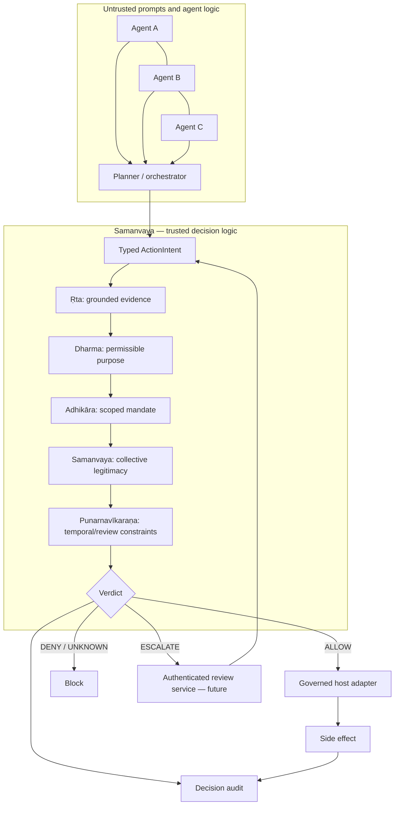

> **v0.2 extension:** the original diagram below describes the action-level
> policy path. A new **plan-time** `CoherenceAnalyzer` checks obligations across
> steps, and a `MinimalRepairExplorer` explores trusted alternatives. The
> `ConstitutionalToolBroker` rechecks whole-plan coherence and exact argument
> digests before invoking the existing gateway. This is a cooperative host
> adapter, not a cryptographic or isolated security boundary. See
> `FRAMEWORK_PORTABILITY.md` and `EXPERIMENT_PROTOCOL.md`.

# Architecture: constitutional control plane, not another agent platform

## Goal and scope

Samanvaya is a **portable control-plane library**. It accepts proposals and exposes decisions. The host agent framework owns prompting, models, execution scheduling, tool implementations, user interfaces, and durable state. Samanvaya owns constitutional decisions and their evidence records. The first target is a **single-process trusted host** with simulated tool callables. Production hardening requires security work listed in [SECURITY.md](SECURITY.md).

## Runtime data model

- `ActionIntent`: immutable proposal describing WHO, WHAT, WHERE, WHY, effect, evidence, and optional collective endorsements.
- `Mandate`: explicitly issued and finite authority for an individual or collective, with allowed actions, resources, purpose, effect, expiry, maximum uses, and delegation parent.
- `MandateBook`: ledger of mandates, revocation and use quotas, plus structural delegation rules.
- `Collective`: hyperedge `(members, quorum, accountable_principal)`, separate from member mandates.
- `HumanApproval`: proposed consent bound to one intent, named reviewer, and expiry.
- `ConstitutionalPolicy`: deterministic, side-effect-free five-pillar evaluator.
- `Decision`: `ALLOW | DENY | UNKNOWN | ESCALATE`, machine-readable reasons.
- `ConstitutionalGateway`: decision + synchronous local audit + reservation + callable. Only supported execution path for governed tools.
- `AuditLog`: ordered JSONL envelope, previous SHA-256 hash and next hash; local corruption detection, not authenticity.
- `replay_constitution`: recomputes decision outcomes against a freshly constructed policy and ledger without executing external effects.

## Boundary diagram



**Current implementation caveat:** this diagram represents the intended trust boundary. The prototype has no mechanism to stop a Python caller from invoking a tool without using `ConstitutionalGateway`.

## Agent hypergraphs rather than simple graphs

Ordinary directed agent edges describe communication and delegation poorly. In Samanvaya, a **hyperedge is itself a bounded organizational actor**. Example:

```text
A = researcher   B = verifier   C = safety critic
H = {A, B, C}    quorum(H) = 2    accountable(H) = human:director
Mandate(H) = read within repo:project, purpose=research, max_uses=4
```

No member gets independent `Mandate(H)` permissions simply by belonging to H. A collective request needs an actor that belongs to H, endorsements from H members, and an explicit group mandate with aligned accountability. This prevents the conventional error `authority(H) := authority(A) ∪ authority(B) ∪ authority(C)`.

### Future collective semantics

Qualified voting, minority veto, dissent preservation, one-time endorsement signatures, multi-stage chains, separations of duties, and dynamic membership are **not** in v0.1. A future hypergraph runtime should distinguish communication, task decomposition, decision quorum, delegation and collective commitments.

## Action lifecycle

1. Host constructs a proposed `ActionIntent`, supplying mandate ID and evidence.
2. Policy checks bounded mandate and active ancestor chain; expired/revoked/quota-exhausted mandates fail closed.
3. Policy checks permitted action, resource, effect and purpose.
4. Collective policies check membership, distinct endorsements, quorum and accountable principal.
5. Evidence requirements yield `UNKNOWN` or `DENY` when unmet.
6. High-impact effects without approval yield `ESCALATE`; an out-of-scope approval yields `DENY`.
7. Gateway writes decision audit before the effect. If audit fails, it does not execute.
8. If allowed, gateway reserves quota, writes `execution_started`, invokes a synchronous callable and writes outcome.
9. Audits may be integrity-checked, semantically diffed, or used for no-side-effect constitutional replay.

## Authorization is not a single boolean

`DENY` signifies a known hard failure; `UNKNOWN` signifies evidence insufficiency; `ESCALATE` requires a separate human authorization; `ALLOW` permits a specifically scoped action. **Only `ALLOW` executes**. Review cannot waive an invalid scope or contradictory evidence.

## Design limits

- Policy input identity, evidence statuses and approval endorsements are strings supplied by host. **They are not trusted attestations**.
- Sync callables only; no transactional external-write rollback.
- Quota and revocation ledger exist in process memory; crash/restart resets them.
- Local trace hash chain does not protect against file deletion, substitution or collusion.
- Tool results are omitted from the audit to reduce accidental disclosure.
- Trace replay re-evaluates decisions only; it neither repeats external effects nor reproduces HUAP's full workflow runner.
- No import/extension of HUAP's no-op `policy/base.py` as a security claim.

## Extension design

The next iteration should isolate `PrincipalVerifier`, `EvidenceVerifier`, `MandateStore`, `ApprovalPort`, `ToolAdapter` and `AuditAnchor` behind versioned protocols and add policy identity/version and replay determinism requirements. Do not add an entire UI, LLM router or second general orchestration framework to this repository.
